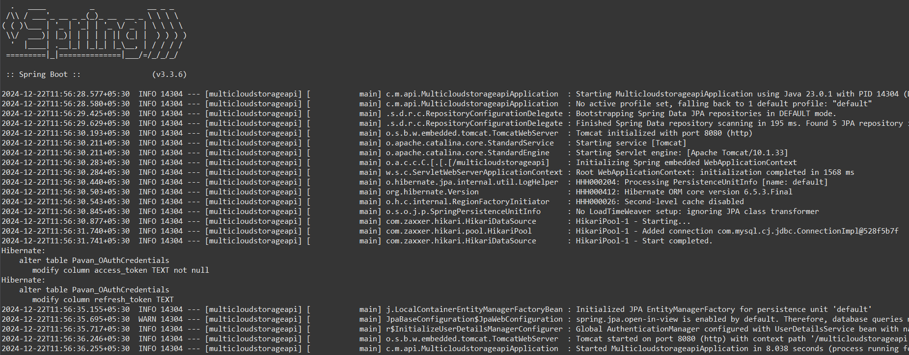
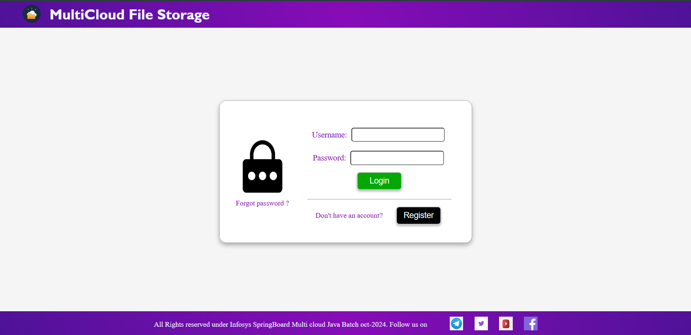
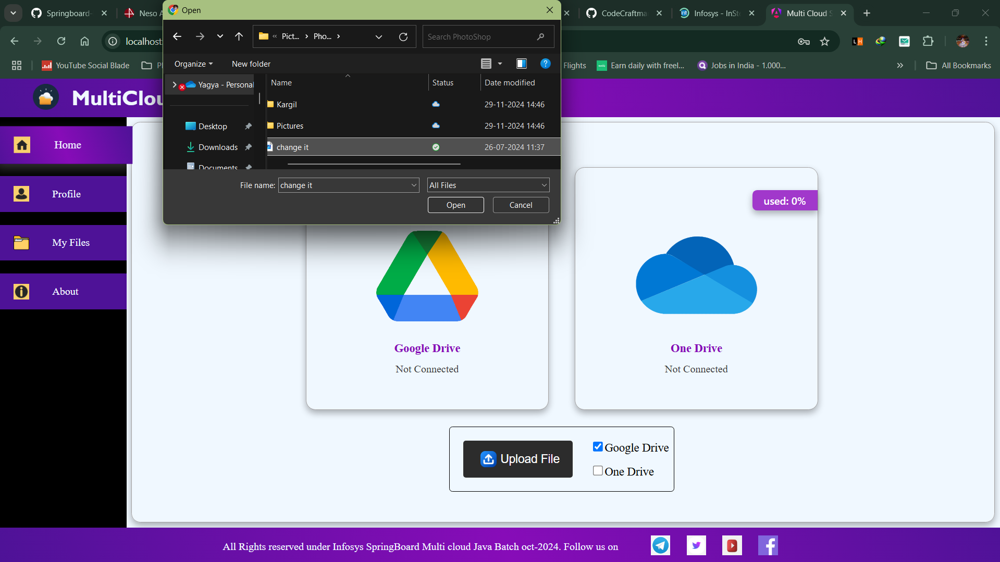
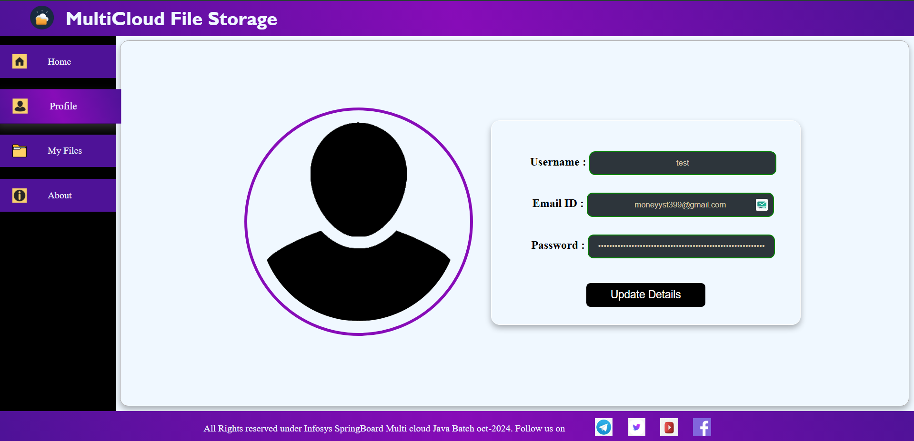
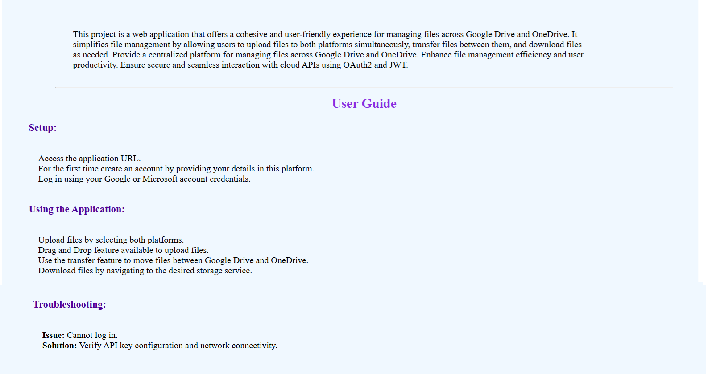

# Multi-Cloud File Storage Application

This project is a comprehensive multi-cloud file storage system built using Spring Boot and Angular. It enables users to manage and store files across multiple cloud platforms. The backend is developed using Spring Boot, connected to a MySQL database, and offers seamless cloud integration. The frontend, built with Angular, provides a user-friendly interface to interact with the system.

## Branches:
- **UI version**: [v1.0.0](https://github.com/Springboard-Internship-2024/Multi-cloud-File-Storage-Application_oct_2024/tree/v1.0.0)
- **Backend version**: [v2.0.0](https://github.com/Springboard-Internship-2024/Multi-cloud-File-Storage-Application_oct_2024/tree/v2.0.0)

## Project Features:
- Cloud file management
- Secure file upload and retrieval
- Multi-cloud platform support

## Output Screenshots:

[
